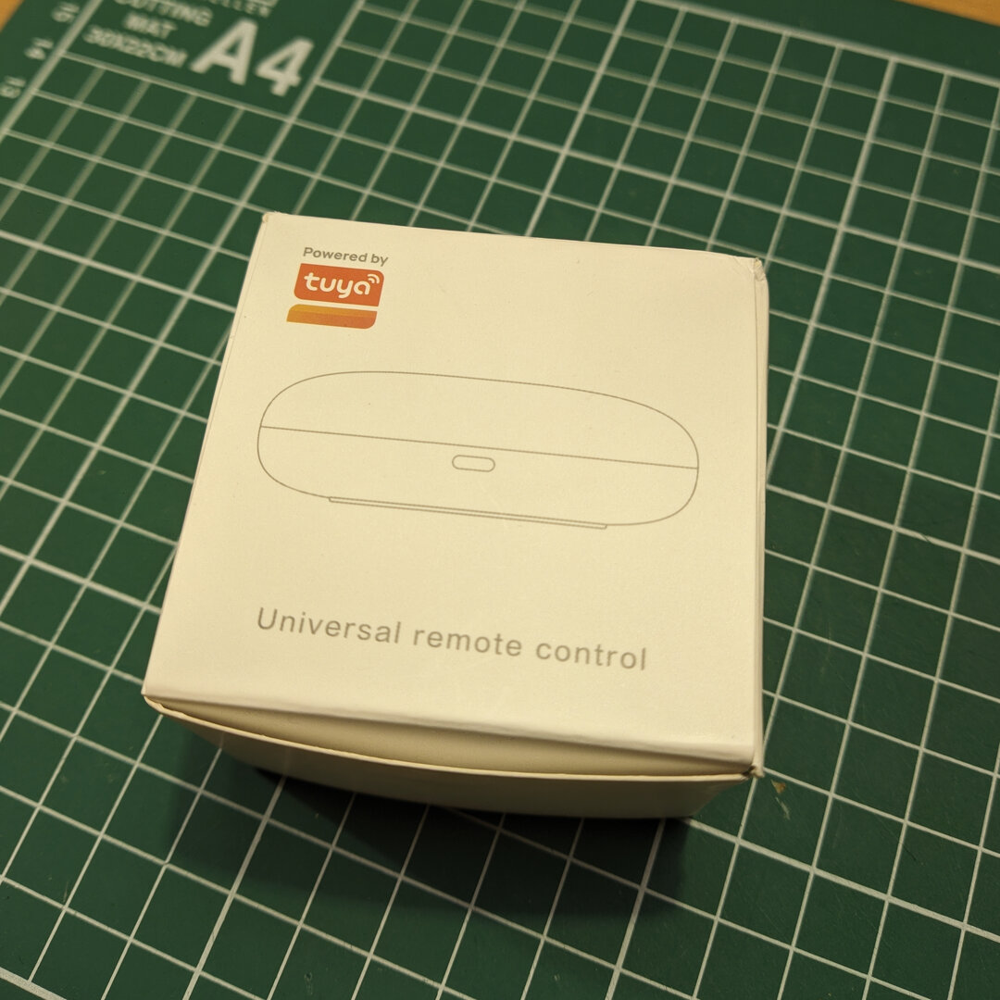
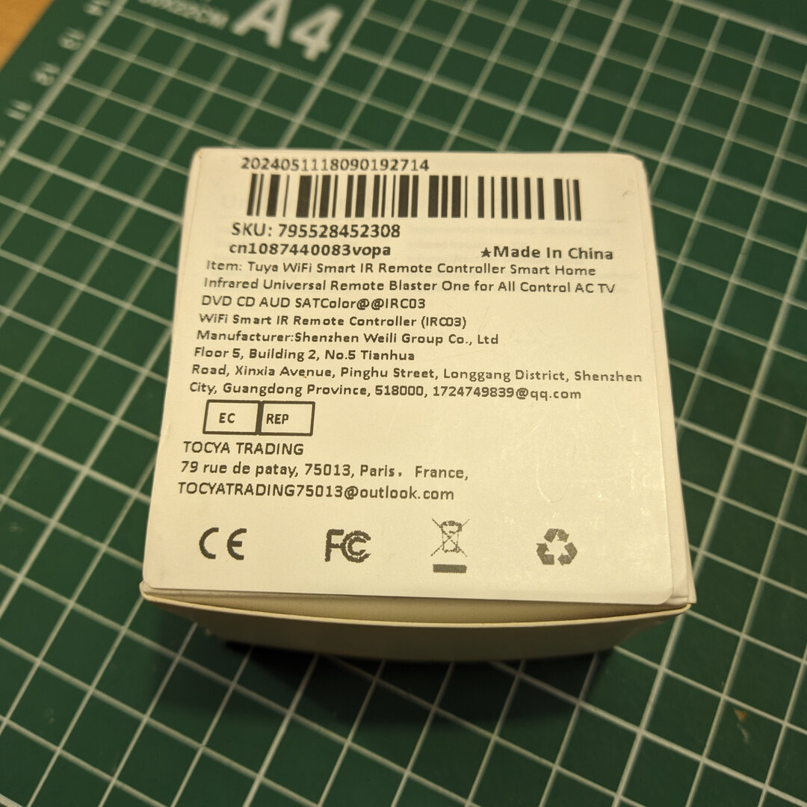
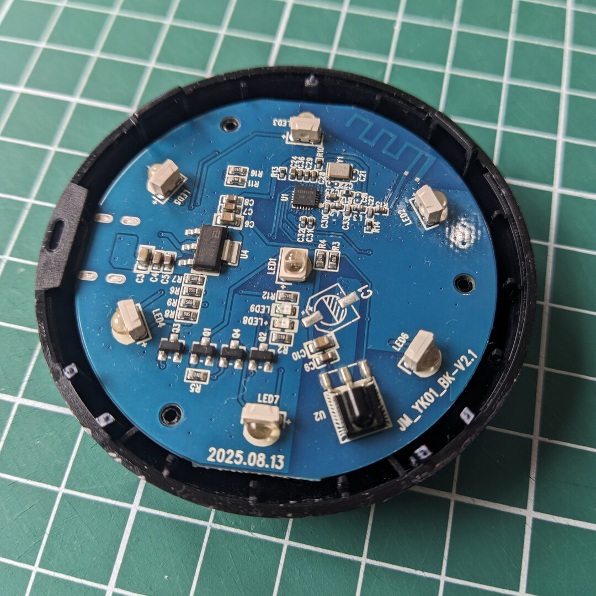
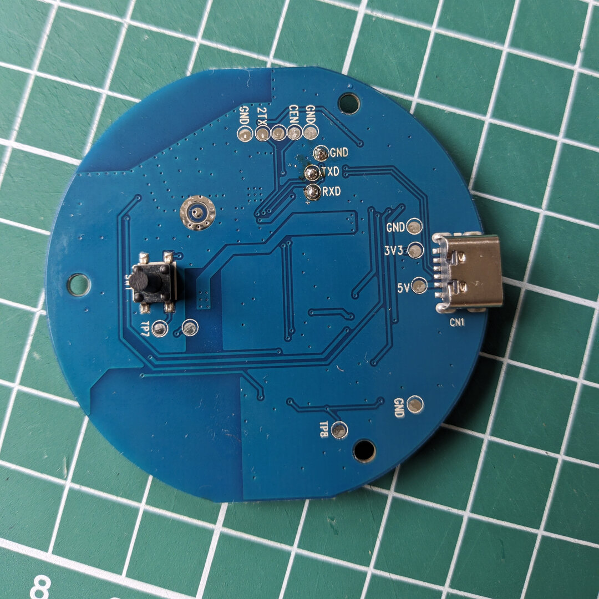
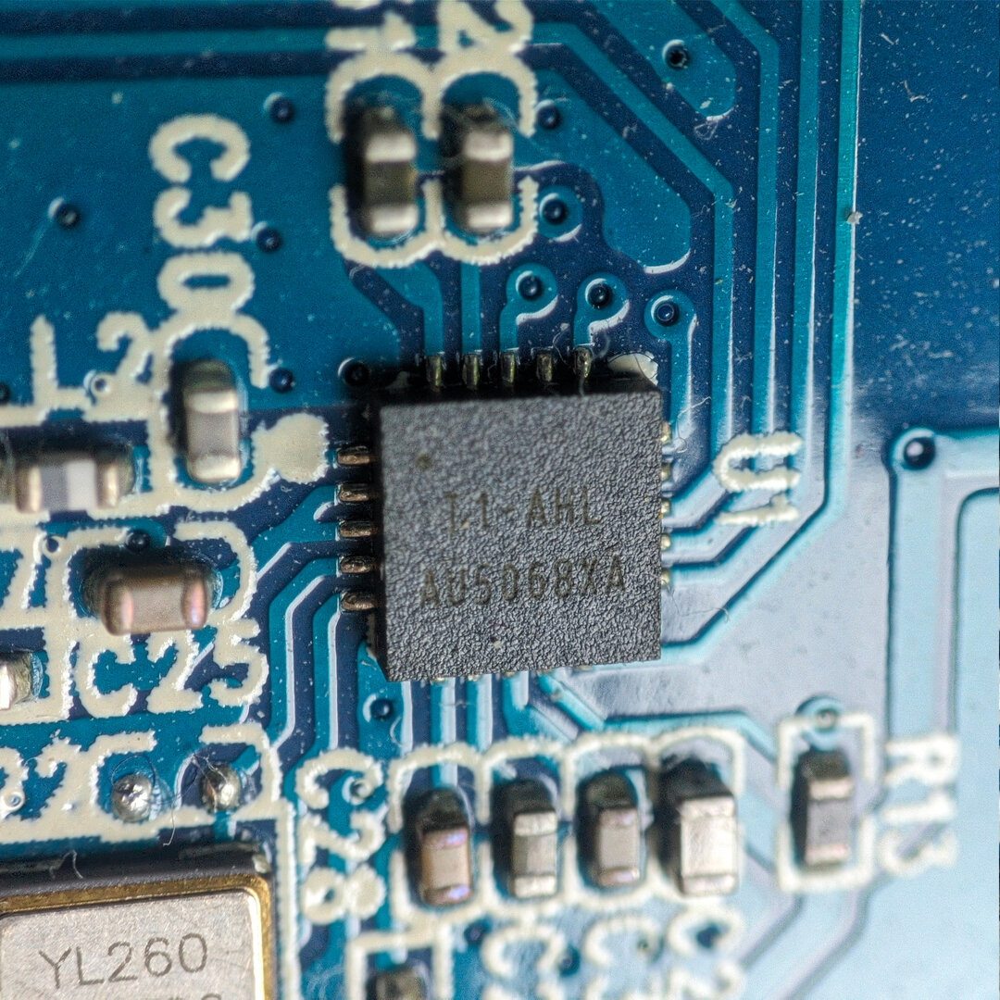
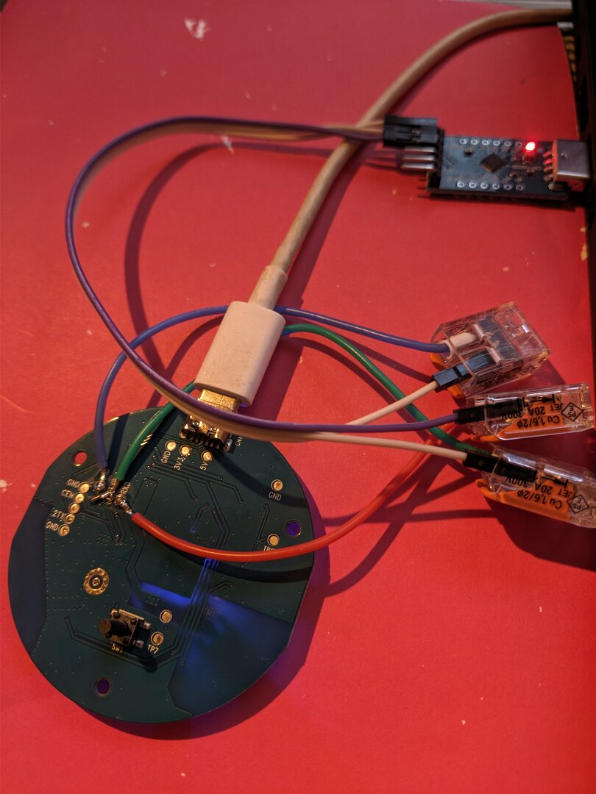

---
date:
  created: 2026-09-08
title: "ESPHome on Tuya IR-Remote"
authors: [codedcactus]
tags: 
  - esphome
  - reverse engineering
---

# ESPHome on Tuya IR-Remote
A while back I bought a Tuya IR-Remote to control my AV equipment using Home Assistant. I've read that it was possible to flash ESPHome, but with so many variants available, it was hard to be sure. Since these units are not very expensive, I gave it a shot and ordered the following [Tuya Wifi Smart IR remote](https://nl.aliexpress.com/item/1005006989554373.html).

## Inspection
The unit arrived in a small cardboard box as shown below. In the box there was a small manual, a USB-C cable and the IR-Remote. As can be seen on the back of the box, the full model name is `WIFI Smart IR Remote Controller (IRC03)`. However, this doesn't tell us if it is possible to flash ESPHome. 

<div class="grid" markdown>
{width="500"}
/// caption
Box front.
///

{width="500"}
/// caption
Box back.
///
</div>

<!-- more -->

To determine if this is the case, we need to determine the chip that is being used, so that it is possible to verify the ESPHome compatibility. The bottom and the top shell for the remote are just clipped together, and can be opened with the use of a plastic wedge/plectrum, etc. Just be careful as the small clips are very prone to damage. I broke two, but could luckily still put the unit back together. 

On the top side of the PCB we can see 7 IR transmitting LEDs, U2 which is the IR receiver and U1 which is the main processor. Furthermore, we can make out the Model number `JM_YK01_BK-V2.1` and the date is marked as `2025.08.13`

The back side houses the USB-C connector, the reset button and some (test) pads including TXD, RXD, CEN, and GND which we will need later.

<div class="grid" markdown>
{width="500"}
/// caption
PCB Top.
///

{width="500"}
/// caption
PCB back.
///
</div>

## Serial Connection
The U1 IC is a **T1-AHL / AU5068XA** which is from the Beken BK7238 chip series. Unfortunately, this chip is not supported by [Tuya Cloudcutter](https://github.com/tuya-cloudcutter/tuya-cloudcutter), so we will have to flash it using a serial connection.

<div class="grid" markdown>
{width="500"}
/// caption
U1 macro shot.
///

{width="500"}
/// caption
Flashing the chip.
///
</div>

I soldered a jumper wire to the GND, RXD and TXD pads on the back of the PCB. The pins should be connected to the USB-TTL adapter as shown in the schematic below.

```
   --------+        +--------------------
        PC |        | BK7231             
   --------+        +--------------------
        RX | ------ | TX1 (GPIO11 / P11) 
        TX | ------ | RX1 (GPIO10 / P10) 
           |        |                    
       GND | ------ | GND                
   --------+        +--------------------
```

Next, let's verify the connection and the chip type by reading the chip info. To do this we're using the [libretiny](https://docs.libretiny.eu/) ltchiptool. 

```sh
ltchiptool flash info bk72xx -d /dev/ttyUSB0
```
You might need to bridge CEN pin to GND with a wire to put the device in download mode.

!!! info "Linux users"

    Linux users might need to add their user to the `dialout` group. Run `sudo usermod -a -G dialout $USER` and logout for the change to take effect.

```sh
(ir blaster) codedcactus@localhost ~/D/p/ir blaster [1]> ltchiptool flash info bk72xx -d /dev/ttyUSB0
I: Connecting to 'Beken 72xx' on /dev/ttyUSB0 @ 115200
I: Connect UART1 of the BK7231 to the USB-TTL adapter:
I: 
I:     --------+        +--------------------
I:          PC |        | BK7231             
I:     --------+        +--------------------
I:          RX | ------ | TX1 (GPIO11 / P11) 
I:          TX | ------ | RX1 (GPIO10 / P10) 
I:             |        |                    
I:         GND | ------ | GND                
I:     --------+        +--------------------
I:  
I: Using a good, stable 3.3V power supply is crucial. Most flashing issues
I: are caused by either voltage drops during intensive flash operations,
I: or bad/loose wires.
I:  
I: The UART adapter's 3.3V power regulator is usually not enough. Instead,
I: a regulated bench power supply, or a linear 1117-type regulator is recommended.
I:  
I: To enter download mode, the chip has to be rebooted while the flashing program
I: is trying to establish communication.
I: In order to do that, you need to bridge CEN pin to GND with a wire.
I: |-- Success! Chip info: BK7238
I: Reading chip info...
I: Chip: BK7238
I: +-----------------------+-------------------------------------+
I: | Name                  | Value                               |
I: +-----------------------+-------------------------------------+
I: | Protocol Type         | FULL                                |
I: | Chip Type             | BK7238                              |
I: | Bootloader Type       | BK7238 2.0.0 (T1)                   |
I: | Chip ID               | 0x7238                              |
I: | Boot Version String   | N/A                                 |
I: |                       |                                     |
I: | Flash ID              | 85 20 15                            |
I: | Flash Size (by ID)    | 2 MiB                               |
I: | Flash Size (detected) | 2 MiB                               |
I: |                       |                                     |
I: | Encryption Key        | 00e87000 00e87000 00e87000 00e87000 |
I: |                       | (likely invalid - unreadable)       |
I: +-----------------------+-------------------------------------+
I: |-- Finished in 12.034 s
```

As we can see the chip is being read correctly, and is shown as a BK7238.

## Firmware dump
Before we get started, we're going to dump the firmware by running the following command. This will help us to extract the pin-mapping later, and will serve as a backup.

```sh
ltchiptool flash read bk72xx tuya-ir-remote-original.bin -d /dev/ttyUSB0
```

```sh
(ir blaster) codedcactus@localhost ~/D/p/ir blaster> ltchiptool flash read bk72xx tuya-ir-remote-original.bin -d /dev/ttyUSB0
I: Connecting to 'Beken 72xx' on /dev/ttyUSB0 @ 115200
I: |-- Success! Chip info: BK7238
I: Reading Flash (2 MiB) to 'tuya-ir-remote-original.bin'
  [################################################################]  100%          
I: |-- Finished in 188.966 s
```

## ESPHome Config
Many Tuya smart devices use the `user_param_key` parameter which can be used by [UPK2ESPHome](https://upk.libretiny.eu/) to generate an ESPHome configuration. I tried to use [bk7231tools](https://github.com/tuya-cloudcutter/bk7231tools) to extract the `user_param_key` from the firmware dump using the following command:
```sh
bk7231tools dissect_dump tuya-ir-remote-original.bin
```

Unfortunately, the tool failed to run, so in the end I had ChatGPT extract the `user_param_key` which is shown below.

```json
{
  "crc": 127,
  "infre": 26,
  "infrr": 6,
  "netnc": 0,
  "netyc": 1,
  "owm": 1,
  "reset_lv": 0,
  "reset_pin": 8,
  "rsthold": 5,
  "wfst_lv": 1,
  "wfst_pin": 24
}
```

Plugging the `user_param_key` into [UPK2ESPHome](https://upk.libretiny.eu/), we get the following ESPHome config:

```yaml
esphome:
  name: REPLACEME

bk72xx:
  board: REPLACEME

logger:

web_server:

captive_portal:

mdns:

api:
  password: ""

ota:
  platform: esphome
  password: ""

wifi:
  ssid: !secret wifi_ssid
  password: !secret wifi_password
  ap:

text_sensor:
  - platform: libretiny
    version:
      name: LibreTiny Version

status_led:
  pin: P24

remote_receiver:
  pin:
    number: P6
    inverted: true
    mode: INPUT_PULLUP
  # dump: all

remote_transmitter:
  pin: P26
  carrier_duty_percent: 50%
```

## Flashing ESPHome
The final step is to compile the ESPHome firmware and flash it to the chip. Add the yaml config to ESPHome, then click the configuration and select `Install -> Advanced options -> Download File Binary`. Once the compilation is done, download the UF2 package.

The first time we have to flash the firmware using the serial connection, once ESPHome is installed you will be able to perform any updates OTA as usual.

To flash the new firmware, run the following command:
```sh
ltchiptool flash write -d /dev/ttyUSB0 tuya-ir-remote-firmware.uf2
```

```sh
(ir blaster) codedcactus@localhost ~/D/p/ir blaster [2]> ltchiptool flash write -d /dev/ttyUSB0 tuya-ir-remote-firmware.uf2
I: Detected file type: UF2 - esphome 2026.8.2
I: Connecting to 'Beken 7238' on /dev/ttyUSB0 @ 115200
I: |-- Success! Chip info: BK7238
I: Writing 'tuya-ir-remote-firmware.uf2'
I: |-- esphome 2026.8.2 @ 2026-09-03 20:37:11 -> generic-bk7238-tuya
Booting firmware  [################################################################]  100%            
I: |-- Finished in 70.607 s
```

And that's it. The Tuya device should now show up in Home Assistant ready to use!